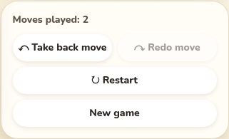
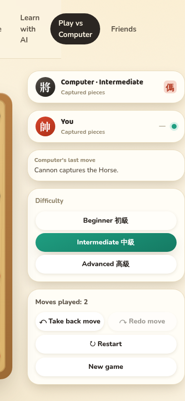
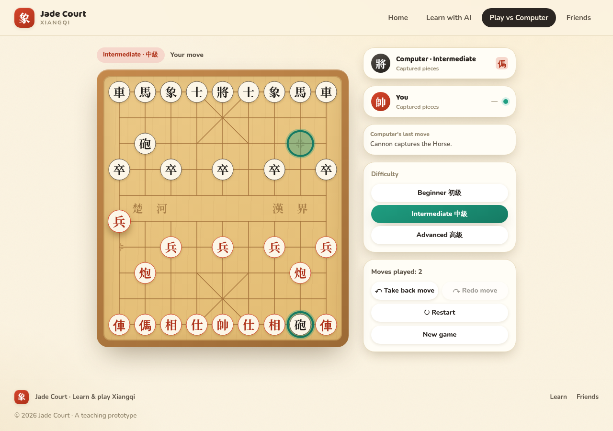
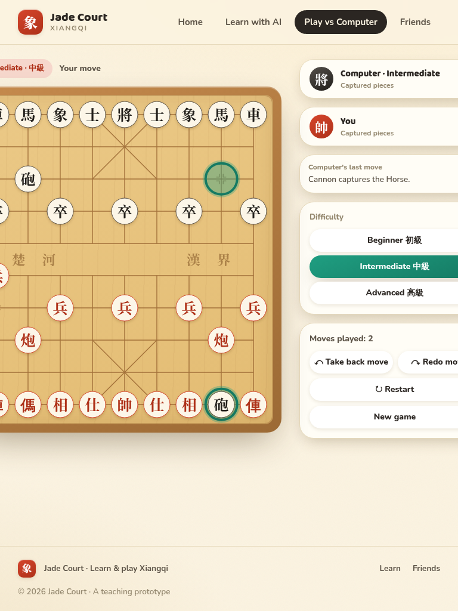
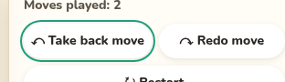
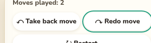
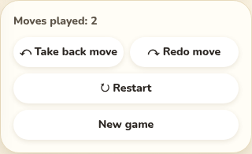

# Review: Take back + Redo button row (#37 follow-up, PR #45)

**Date:** 2026-10-13 · **Mode:** Review · **Screen:** `PlayScreen` → "Moves played" card · **Binding spec:** `spec-amendment-button-row.md` §5 checklist · **Change under review:** the two buttons wrapped in `
`, each `btn btn-ghost btn-sm flex-1 px-2`; Restart / New game unchanged below.

## Verdict: PASS WITH ISSUES

Ship it. All five checklist items pass visually and functionally; the only finding is a **nit** — the two pills differ in width by ~2px (checklist item 2 asks for "exactly equal"), caused by the longer label's minimum content width, and invisible to the eye.

**Environment:** worktree `issue-37-redo-moves`, server `PORT=3038 pnpm --filter @jade-court/server dev` (Pikafish unconfigured → negamax fallback, confirmed working: "Cannon captures the Horse"), web `vite --port 5210` with `JADE_API_PROXY_TARGET=http://localhost:3038`. Headless Chromium via a throwaway `review-driver.mjs` that has since been removed (per repo policy: scratch scripts are not committed; this write-up and the screenshot dump below are the durable record). Zero console errors, zero failed requests across the whole run.

---

## Item 1 — 375px: one row, no clipping, no new overflow — **PASS**

| Check                                    | Measured                                                                                                                                                                     | Result |
| ---------------------------------------- | ---------------------------------------------------------------------------------------------------------------------------------------------------------------------------- | ------ |
| Both buttons on one row inside the card  | row 286×38px, both pills y-aligned                                                                                                                                           | ✓      |
| "↶ Take back move" fully inside its pill | `scrollWidth 140 = clientWidth 140` → no clipped/overflowing text                                                                                                            | ✓      |
| Row adds no new horizontal overflow      | row `scrollWidth 286 = clientWidth 286`; page `scrollWidth 626 > innerWidth 375` is the pre-existing page-level overflow below ~1100px (documented, spec §2) — not a finding | ✓      |

Note: the card content box measures **286px** (320 card − 2×1px border − 2×16px padding), not the 288px the amendment's fit-check assumed — the 2px card border wasn't subtracted. The label still fits (see Finding 1).

## Item 2 — Mixed state, 1280px: equal pills, disabled at 45% — **PASS** (with Finding 1)

| Check                             | Measured                                                   | Result                       |
| --------------------------------- | ---------------------------------------------------------- | ---------------------------- |
| Heights equal, top/bottom aligned | both 38px, same `y` 588.06 / `bottom` 626.06               | ✓ exact                      |
| Disabled pill at 45% opacity      | computed `opacity: 0.45` on Redo                           | ✓                            |
| Widths exactly equal              | Take back **139.98px** vs Redo **138.02px** → Δ **1.97px** | ✗ ~2px off — Finding 1 (nit) |

## Item 3 — Both enabled, 768px (after take-back) — **PASS**

Reached by playing two rounds, then one take-back → history 2, redo 2, both buttons enabled (a take-back from a single round leaves history 0, which disables Take back — two rounds are needed for this state).

| Check                              | Measured                                                        | Result |
| ---------------------------------- | --------------------------------------------------------------- | ------ |
| Each label on a single line        | `oneLine: true` for both (all text-range rects share one `top`) | ✓      |
| 8px gap between pills              | computed `column-gap: 8px`; `Redo.x − TakeBack.right = 8`       | ✓      |
| Pair spans full card content width | row 286px = card clientWidth 318 − 2×16 padding                 | ✓      |

## Item 4 — Keyboard focus on either button — **PASS**

Real keyboard Tab presses (15 tabs from the top to reach Take back; one more for Redo). Computed style on both: `outline: 2px solid rgb(31, 158, 129)` — the jade token — with `outline-offset: 2px`. The ring extends 4px past the border box into the 8px gap, leaving 4px clearance: full ring visible, never clipped by or touching the sibling. Confirmed in pixels in both closeups.

## Item 5 — Regression: Restart / New game — **PASS**

| Check                   | Measured                               | Result |
| ----------------------- | -------------------------------------- | ------ |
| Full-width              | both 286px = card content width        | ✓      |
| Stacked, original order | Restart (y 634) above New game (y 680) | ✓      |
| Original `gap-2` rhythm | row→Restart 8px, Restart→New game 8px  | ✓      |

---

## Findings

### Finding 1 — nit — pills differ in width by ~2px

- **Where:** "Moves played" card, all breakpoints (width-independent), both states.
- **Problem:** checklist item 2 asks for exactly equal widths; measured Take back 139.98px vs Redo 138.02px (Δ 1.97px). Mechanism: with `flex-1`, each pill's equal share of the 286px row is 139px, but "↶ Take back move" (`whitespace-nowrap`, `min-width: auto`) has a minimum content width of ~140px in this Chromium/font-fallback stack, so the flex algorithm clamps it to 140px and Redo absorbs the difference. The amendment's claim that "widths never depend on font metrics" doesn't hold at the extreme edge — the longer label is exactly at the fit limit (its `scrollWidth` equals its `clientWidth`: zero slack).
- **Why it's a nit, not minor:** the 2px difference is imperceptible in the screenshots (edges align visually); no text is clipped; no overflow; no layout shift between states.
- **Recommendation:** accept as-is. Adding `min-w-0` would force exact 139px equality but lets the label touch/overflow the pill border by ~1px on systems whose ↶ fallback glyph is wider — strictly worse. The real safety margin comes from the label length, which is unchanged and out of scope. Flag for the future: the spec's worst-case symbol-font fallback (~129px text) would overflow this pill; if we ever see that platform, shorten the label (e.g. "↶ Take back") rather than shrink the font.

## Matches spec

- Markup exactly as amended: `
` wrapping only the pair; `btn btn-ghost btn-sm flex-1 px-2` on each; Restart / New game untouched (`btn btn-ghost btn-sm`, full-width, same order).
- No CSS/token changes; disabled styling via existing `.btn:disabled` (opacity 0.45); focus via existing `.btn:focus-visible` jade outline.
- No behavior change: take-back and redo both drove real engine state correctly in the browser (history 2 → 4 → take-back → 2; redo stack preserved/cleared as designed).

## Not reviewed

- **Hover state** (`.btn-ghost:hover` background) — unchanged by this diff and not reachable in headless stills.
- **AI-thinking transient** (Redo disabled while the computer thinks) — enable/disable logic untouched by the diff; not exercised mid-think.
- **Platforms with a wider ↶/↷ fallback glyph** (e.g. some Android/Windows symbol fonts) — the spec's flagged overflow risk; only this Linux/Chromium stack was measured (see Finding 1).
- **Mobile top-nav wrapping at 375px** (visible in `row-02`) — pre-existing, unrelated to this change; noted here only for the record.

## Checklist result summary

| #   | Item                                                        | Result                               |
| --- | ----------------------------------------------------------- | ------------------------------------ |
| 1   | 375px one row, no clipping, no new overflow                 | PASS                                 |
| 2   | Mixed state 1280px: equal pills, 45% disabled               | PASS (widths Δ~2px → Finding 1, nit) |
| 3   | Both enabled 768px: single-line labels, 8px gap, full width | PASS                                 |
| 4   | Keyboard focus: full jade ring, no sibling contact          | PASS                                 |
| 5   | Regression: Restart / New game stacked, original spacing    | PASS                                 |
