# Review: Redo taken-back moves in Play vs Computer (#37)

**Date:** 2026-10-13 · **Mode:** Review · **Screen:** `PlayScreen` · **Verdict:** **PASS**

Reviewed the uncommitted diff in the issue worktree (`apps/web/src/screens/PlayScreen.tsx`, `apps/web/src/index.css`, plus behavior in `apps/web/src/hooks/useXiangqiGame.ts`) against [spec.md](spec.md). Ran web on `:5210` + server on `:3038` from the worktree and drove the flow in headless Chromium at 1280 / 768 / 375 px.

## Verified against spec — everything passes

| Spec item                                                                                    | Result                                                                                                                                                                             | Evidence        |
| -------------------------------------------------------------------------------------------- | ---------------------------------------------------------------------------------------------------------------------------------------------------------------------------------- | --------------- |
| Placement: directly below Take back, before Restart (§2)                                     | ✅ DOM order = visual order: Take back → Redo → Restart → New game                                                                                                                 | shot 01, 03     |
| Label `↷ Redo move`, `btn btn-ghost btn-sm`, native `disabled` (§4.1)                        | ✅ exact match in DOM                                                                                                                                                              | shot 01         |
| `aria-label="Redo move"` (§4.1); Take back gains `aria-label` + tooltip (§6/§9 optional nit) | ✅ both present                                                                                                                                                                    | a11y tree, eval |
| Tooltip enabled: `Redo the moves you took back (Ctrl+Shift+Z)` (§6)                          | ✅ exact                                                                                                                                                                           | eval            |
| Tooltip empty stack: `Nothing to redo` (§6)                                                  | ✅ exact                                                                                                                                                                           | eval            |
| Tooltip computer thinking: `Wait for the computer to move` (§5)                              | ✅ in code; practically unreachable — NIT-1                                                                                                                                        | diff            |
| Disabled initially / after a fresh pair (§5)                                                 | ✅ `disabled`, 45% opacity, `Nothing to redo`                                                                                                                                      | shots 01, 02    |
| Take back one pair → Redo enables (§5)                                                       | ✅ count 0, card hidden, `Redo the moves you took back…`                                                                                                                           | shot 03         |
| Redo restores board + "Computer's last move" card + count, then disables (§5, §7)            | ✅ cannon back at 7-4, `computer-lastmove` highlight on the restored chariot, card text verbatim (`Chariot advances.` / `Cannon advances.`), `Moves played: 2`, status `Your move` | shot 04         |
| No opponent API call on undo/redo (§1)                                                       | ✅ request counter: exactly **1** `/api/opponent/move` across move → undo → redo; redo adds **zero**                                                                               | network audit   |
| Exit branch: new move after take-back clears stack (§2)                                      | ✅ Redo disables, tooltip back to `Nothing to redo`                                                                                                                                | eval            |
| No layout shift in the card when Redo toggles (§3)                                           | ✅ card height 240 px in both states                                                                                                                                               | measured        |
| Hover on enabled Redo (§5)                                                                   | ✅ `bg #fffdf6`, `line-soft` border — the standard `.btn-ghost` hover                                                                                                              | computed style  |
| `.btn:focus-visible` jade ring on all four buttons (§4.3, §9)                                | ✅ `outline: 2px solid rgb(31,158,129)`, offset 2px, keyboard-driven; siblings unmoved                                                                                             | shots 05–08     |
| App-wide rule causes no regression (Home / Learn)                                            | ✅ ring renders on `Start learning →` and `💡 Show me a hint`, layouts intact                                                                                                      | shots 09, 10    |
| Keyboard: `Ctrl+Z` undoes, `Ctrl+Shift+Z` redoes (§8)                                        | ✅ both fire; `Ctrl+Shift+Z` with empty stack is a clean no-op (no preventDefault swallow)                                                                                         | scripted keys   |
| Design system: bamboo board, flat pieces, jade accent, cream bg; board never covered/shrunk  | ✅ unchanged                                                                                                                                                                       | shots 01–04     |
| 768 / 375 px side-panel behavior (§3)                                                        | ✅ buttons full-width in card; horizontal overflow pixel-identical to the pre-change spec screenshots (pre-existing `.game-layout-wide`, §10 out of scope)                         | shots 11, 12    |
| Reduced motion (§7)                                                                          | ✅ no new animation introduced                                                                                                                                                     | diff            |

## Findings

### NIT-1 — "Wait for the computer to move" tooltip is unreachable in practice

**Where:** `PlayScreen.tsx` redoTitle logic · **Severity:** nit
In Play, any human move clears the redo stack, so `redoCount ≥ 2 && aiThinking` can never co-occur — the same practical-unreachability the spec already documented for the game-over state (§5). The branch is harmless defensive copy and matches the spec table; leave as-is.

### NIT-2 — Disabled-state tooltips never surface on hover in Chrome

**Where:** Redo / Take back buttons, disabled state · **Severity:** nit
Native `disabled` suppresses `title` tooltips, so `Nothing to redo` is never actually shown on hover; the 45%-opacity look is the only signal. This is exactly the trade-off spec §5 called out ("progressive enhancement only; the 45%-opacity disabled look is the primary signal"), and it matches Take back. No action.

### Note — pre-existing overflow at ≤768 px

The `.game-layout-wide` horizontal overflow at 768/375 px is unchanged from the pre-change captures in `spec.md` (compared side by side). Out of scope per §10.

## Matches spec

All of it. Button order, copy, tooltips, aria-labels, disabled pattern, hook contract (`redoCount` / `redoLast(2)`, verbatim card text restoration), the one-rule `.btn:focus-visible` addition in `@layer components`, keyboard-shortcut gating (`preventDefault` only when the action fires, input-field guard), and zero-API-call redo — each verified live in the browser, not just in the diff. The developer's two recorded deviations (E2E selector retarget for the new Take back aria-label; test-helper signature) are test-internal and invisible to users.

## Not reviewed

- **`Ctrl+Y` keystroke** — shares the exact code branch as `Ctrl+Shift+Z` (`isY && e.ctrlKey`); covered by the unit tests. Headless Linux env; verified by code read only.
- **Real screen readers** (NVDA/VoiceOver) — labels verified in the accessibility tree (`Redo move`, `Take back move`), not by ear.
- **AI-thinking disabled state in a live capture** — unreachable in practice (NIT-1); Beginner replies too fast to catch mid-flight reliably.
- **Environment hiccup (not a defect):** the pre-existing dev server on `:3038` died mid-review; the app fell back to the local engine as designed (a nice accidental confirmation of the fallback path). I restarted the server and re-ran the full cycle with **zero** failed requests before concluding.

## Screenshots

| #                                                                      | State                                                      |
| ---------------------------------------------------------------------- | ---------------------------------------------------------- |
| 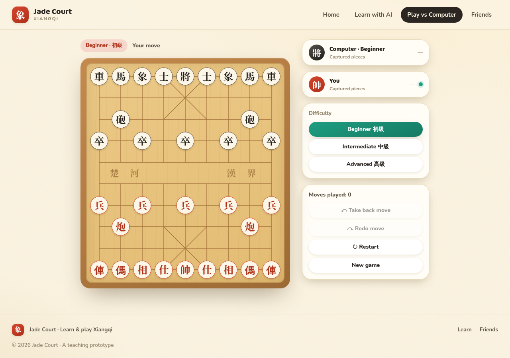       | 1280px initial — Redo present, disabled, correct order     |
|                   | 1280px after one pair — Redo still disabled, card visible  |
| 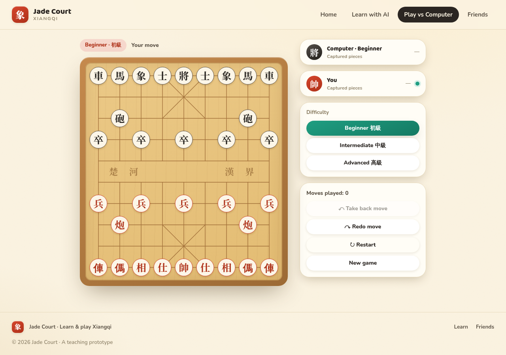 | 1280px after take-back — Redo enabled, card hidden         |
| 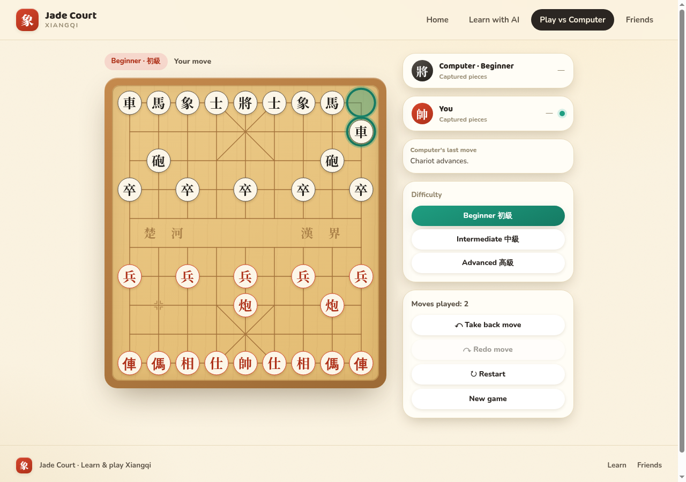         | 1280px after redo — exact restoration, Redo disabled again |
| 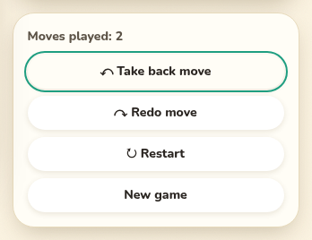              | Focus ring — Take back                                     |
| 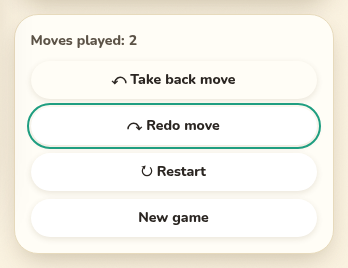                  | Focus ring — Redo                                          |
| 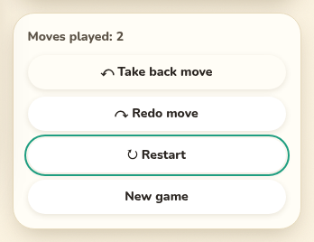               | Focus ring — Restart                                       |
| 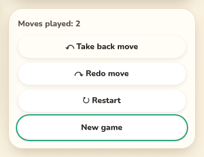               | Focus ring — New game                                      |
| 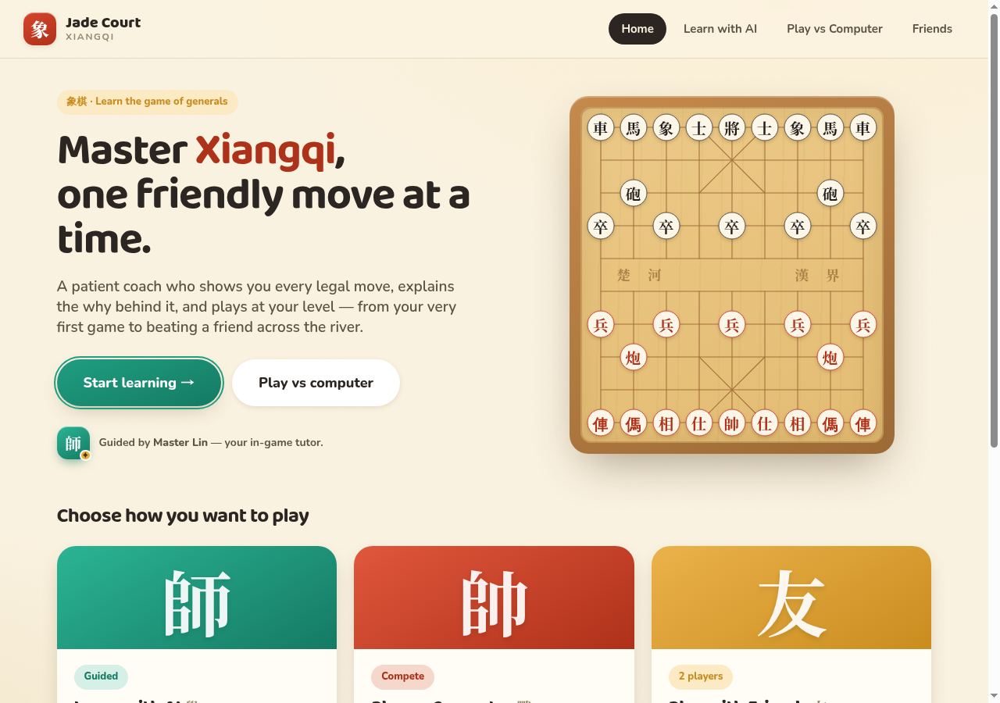                  | Home regression check                                      |
| 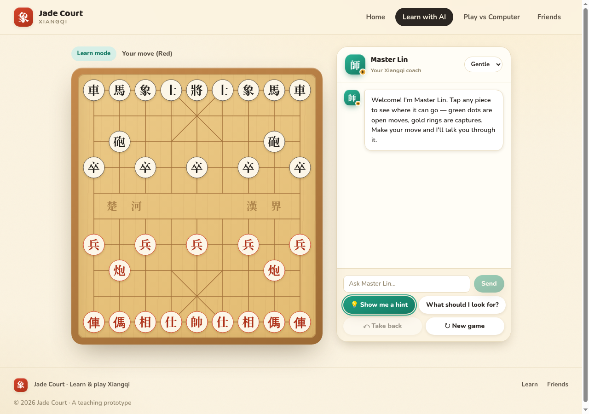                 | Learn regression check                                     |
| 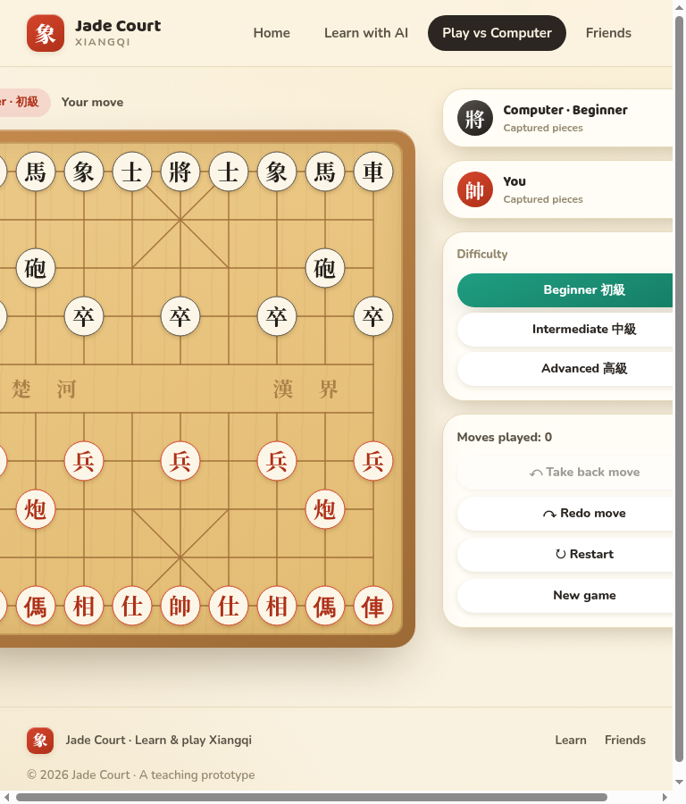                 | 768px — Redo enabled (pre-existing overflow unchanged)     |
| 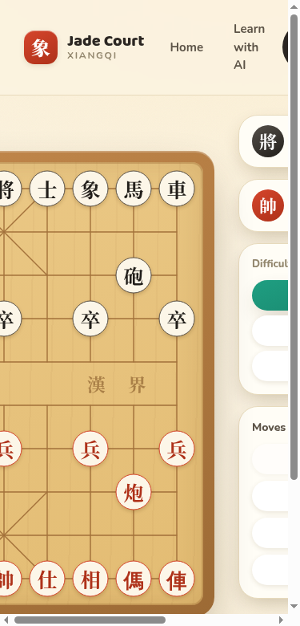                 | 375px — same                                               |

**Recommendation:** ship as-is.
