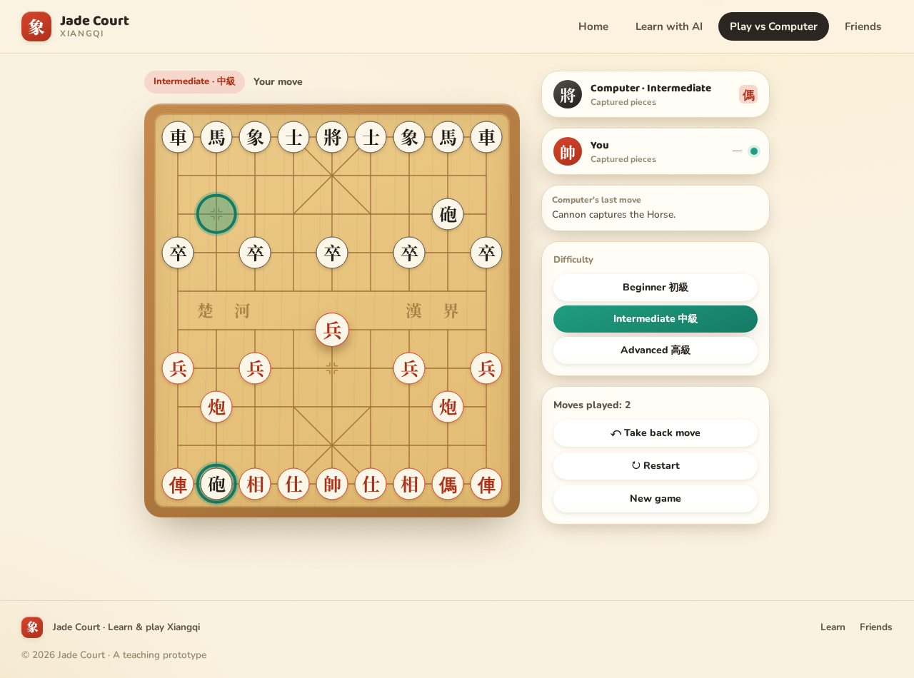
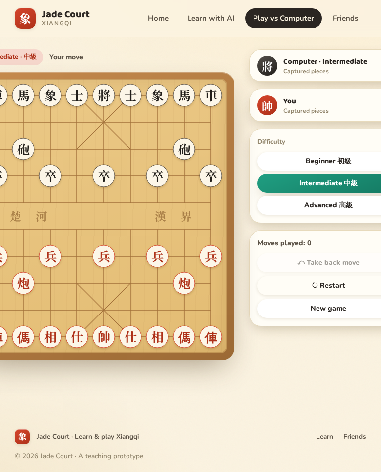
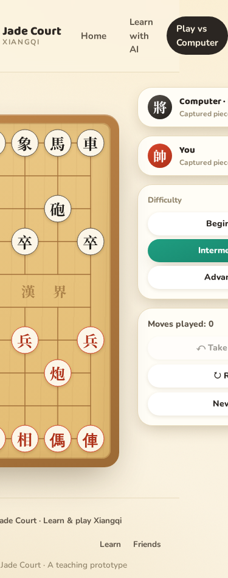
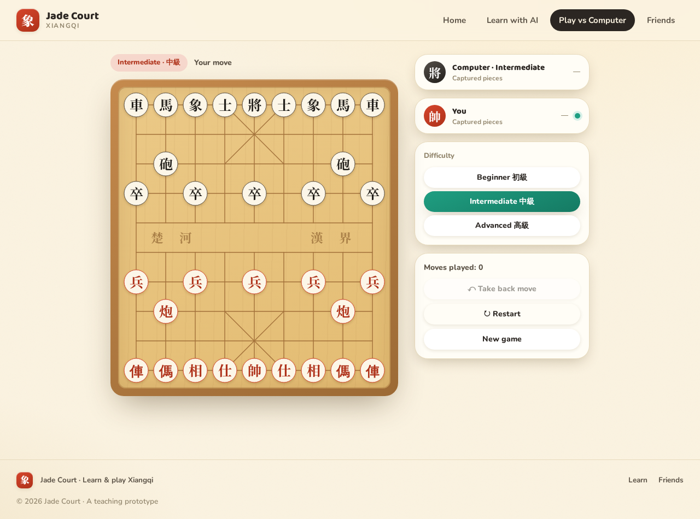

# Spec: Redo taken-back moves in Play vs Computer (#37)

**Date:** 2026-10-13 · **Mode:** Spec · **Screen:** `PlayScreen` (Play vs Computer) · **Issue:** #37

## 1. Goal and user story

A casual player in **Play vs Computer** presses **↶ Take back move** once too often (or just wants to peek at an earlier position). Today the taken-back moves are discarded, so there is no way forward again except replaying by hand — and the computer may answer differently. With Redo, the player can step **forward** through exactly the moves they took back, including the computer's _original_ replies, with no new opponent API call.

**Success criteria**

- One click on **↷ Redo move** restores the most recently taken-back pair (player move + computer reply), instantly and offline.
- The button is disabled (and obviously so) whenever redo is impossible or unsafe.
- After a redo, board, turn, move count, last-move highlights, check status, and the "Computer's last move" card all match the pre-take-back state.

## 2. Placement and flow

**Where:** the existing side-panel card that begins with `Moves played: {game.history.length}` — the bottom card in the right column of `Game` in `apps/web/src/screens/PlayScreen.tsx` (`<div className="card p-4 flex flex-col gap-2">`).

**Button order** (top → bottom). Redo slots in as the sibling of Take back, keeping the undo/redo pair adjacent and the destructive/session actions below:

1. `↶ Take back move` (unchanged)
2. **`↷ Redo move` (new)**
3. `↻ Restart` (unchanged)
4. `New game` (unchanged)

**Flow:**

| Step          | Actor                                                                                    | Result                                                                                                 |
| ------------- | ---------------------------------------------------------------------------------------- | ------------------------------------------------------------------------------------------------------ |
| 1             | Player takes back one or more pairs                                                      | Redo button becomes enabled (stack ≥ 2 plies)                                                          |
| 2             | Player clicks `↷ Redo move` (or presses the redo shortcut)                               | The newest taken-back pair is replayed from stored history; no API call; board/turn/count/card restore |
| 3             | Repeat 2                                                                                 | One pair per click until the stack is empty → button disables                                          |
| Exit branches | Player makes a **new** move after taking back / presses `↻ Restart` / presses `New game` | Redo stack clears; button disables                                                                     |

Entry: any active game after at least one take-back. Exit: stack empty, new move, Restart, or New game.



## 3. Layout

No layout change. The new button is one more full-width row in the existing `flex flex-col gap-2` card; buttons stretch to the card width automatically.

| Breakpoint        | Behavior                                                                                                                                        |
| ----------------- | ----------------------------------------------------------------------------------------------------------------------------------------------- |
| Desktop (≥1024px) | Right column is 320px (`.game-layout-wide`); card stacks the four buttons full-width.                                                           |
| Tablet (~768px)   | Same card, same stacking. (Pre-existing: `.game-layout-wide` does not collapse, page scrolls horizontally — unchanged by this feature, see §9.) |
| Phone (~375px)    | Same. Buttons remain full-width inside the card.                                                                                                |




## 4. Components

### 4.1 Redo button (new)

| Property     | Value                                                                             |
| ------------ | --------------------------------------------------------------------------------- |
| Element      | `<button type="button">`                                                          |
| Classes      | `btn btn-ghost btn-sm` — identical to its three siblings. No new component class. |
| Content      | `↷ Redo move` — glyph **↷** (U+21B7), mirroring Take back's ↶ (U+21B6)            |
| `disabled`   | `game.redoCount < 2 \|\| !yourTurn \|\| game.aiThinking` (see §5)                 |
| `onClick`    | `() => game.redoLast(2)` — restores one pair, mirroring `undoLast(2)`             |
| `aria-label` | `Redo move` (so screen readers announce words, not the U+21B7 glyph name)         |
| `title`      | State-dependent, see §6                                                           |

Reuse-first: no new tokens or component classes are needed for the button itself.

### 4.2 Hook contract the UI consumes (`useXiangqiGame`)

Not UI, but the screen depends on these exact additions:

- `redoCount: number` — plies currently on the redo stack (always a multiple of 2 in Play).
- `redoLast(count = 1)` — replays `count` stored plies without any opponent API call; safe no-op when fewer than `count` plies are stacked.
- After `redoLast`, the hook recomputes `lastOpponentMoveText` from restored history (same way `undoLast` already does), so the "Computer's last move" card reappears with the original text.
- Redo must not trigger the opponent-move effect, and an opponent request still in flight during undo/redo must be discarded (per issue notes).

### 4.3 Proposed CSS addition (one rule, benefits all buttons)

There is currently **no visible focus style on `.btn`** (only `.level-card` has one). WCAG 2.4.7 requires visible focus. Add to `@layer components` in `apps/web/src/index.css`, mirroring the level-card pattern:

```css
.btn:focus-visible {
  outline: 2px solid var(--jade);
  outline-offset: 2px;
}
```

## 5. States

Redo is enabled only when **all** hold: `redoCount >= 2`, it is the player's turn (`yourTurn` — also false at game over), and the computer is not thinking.

| State                 | Condition                                   | Visual                                                                                                                             | Copy / tooltip (`title`)                                                                                     | aria                                                                            |
| --------------------- | ------------------------------------------- | ---------------------------------------------------------------------------------------------------------------------------------- | ------------------------------------------------------------------------------------------------------------ | ------------------------------------------------------------------------------- |
| **Normal (enabled)**  | `redoCount >= 2 && yourTurn && !aiThinking` | Standard `.btn-ghost`: white bg, `line-soft` border, `shadow-sm`; hover `bg-[#fffdf6]`; active press `translate-y-px scale-[0.99]` | `Redo the moves you took back (Ctrl+Shift+Z)`                                                                | `aria-label="Redo move"`                                                        |
| **Empty stack**       | `redoCount < 2`                             | Native `disabled` → existing `.btn:disabled` (`opacity-45`, `cursor-not-allowed`), no hover                                        | `Nothing to redo`                                                                                            | native `disabled` (matches Take back's pattern; do **not** use `aria-disabled`) |
| **Computer thinking** | `aiThinking` (or not your turn)             | Same disabled styling                                                                                                              | `Wait for the computer to move`                                                                              | same                                                                            |
| **Game over**         | `game.status` set (via `!yourTurn`)         | Same disabled styling                                                                                                              | none (button unreachable in practice: Take back is disabled at game over, so no stack can exist — see §9 Q1) | same                                                                            |

Notes for the implementer:

- Use the native `disabled` attribute, exactly like the Take back button, for consistent styling and tab-order behavior.
- `title` on a disabled button does not reliably tooltip in Chrome — treat the titles on disabled states as progressive enhancement only; the 45%-opacity disabled look is the primary signal.
- The moves-played counter needs no change: it reads `game.history.length`, which grows by 2 on redo automatically.

## 6. Copy

| Element                                                      | Text                                          |
| ------------------------------------------------------------ | --------------------------------------------- |
| Button label                                                 | `↷ Redo move`                                 |
| `aria-label`                                                 | `Redo move`                                   |
| Tooltip, enabled                                             | `Redo the moves you took back (Ctrl+Shift+Z)` |
| Tooltip, empty stack                                         | `Nothing to redo`                             |
| Tooltip, computer thinking                                   | `Wait for the computer to move`               |
| Take back tooltip (small consistency tweak while we're here) | `Take back your last move (Ctrl+Z)`           |

## 7. Feedback on redo

When redo fires, the player should perceive "the game jumped forward to exactly where I was":

- **Board:** pieces restore; the last-move highlight shows the **computer's** restored reply (the last ply of the pair). In `PlayScreen`, `humanLastMove` becomes `null` and `computerLastMove` repopulates automatically — verify this works, no extra UI needed.
- **"Computer's last move" card:** reappears with the original description text (restored by the hook from history, not regenerated).
- **Status line:** returns to `Your move`; `Check!` pill reappears if the restored position was check.
- **Moves played:** increases by 2.
- **No toast, no sound, no overlay** — undo today gives no extra feedback; redo matches it. Instant application is the feedback.
- **Motion:** none new. No `rise`/`pop` on the button or board. `prefers-reduced-motion`: nothing to reduce.

## 8. Keyboard shortcuts

Include them (the issue marks them optional; they cost little and matter for mouse-free play):

| Keys                               | Action        | Fires only when                       |
| ---------------------------------- | ------------- | ------------------------------------- |
| `Ctrl/Cmd+Z`                       | `undoLast(2)` | the Take back button would be enabled |
| `Ctrl/Cmd+Shift+Z` **or** `Ctrl+Y` | `redoLast(2)` | the Redo button would be enabled      |

Implementation rules:

- Register one `keydown` listener on `window` inside the `Game` component (mounted only during an active game — the Setup screen never sees it).
- Match `e.key.toLowerCase() === 'z'` with `(e.ctrlKey || e.metaKey)`; `e.shiftKey` selects redo; also accept `e.key.toLowerCase() === 'y' && e.ctrlKey` for redo.
- Call `e.preventDefault()` only when the corresponding action actually fires (don't swallow the browser's own undo when the button would be disabled).
- **Guard:** ignore events whose `target` is an `input`, `textarea`, `select`, or `isContentEditable` — standard safety even though the Play game screen currently has no text fields.
- Do not fire while the game-over overlay is up (covered by the `yourTurn` enable check).
- Surface the shortcuts only via the `title` tooltips in §6. No visible hint text — the panel stays minimal.

## 9. Accessibility

| Concern          | Spec                                                                                                                                                                            |
| ---------------- | ------------------------------------------------------------------------------------------------------------------------------------------------------------------------------- |
| Focus visibility | New `.btn:focus-visible` jade outline (§4.3) — applies to all four buttons in the card                                                                                          |
| Focus order      | DOM order = visual order: Take back → **Redo** → Restart → New game                                                                                                             |
| Disabled pattern | Native `disabled` (consistent with Take back). Disabled buttons leave the tab order — acceptable here since the action is genuinely unavailable                                 |
| Screen reader    | `aria-label="Redo move"`; glyph is decorative. (Optional nit: give Take back `aria-label="Take back move"` the same way)                                                        |
| Touch target     | `btn-sm` is ~38px tall — below the 44px guideline, but identical to every sibling on this screen. Changing `btn-sm` globally is out of scope for #37; flagged for a future pass |
| Color            | No new color meaning introduced; enabled/disabled conveyed by opacity + cursor + label, not color alone                                                                         |
| Reduced motion   | No new animation                                                                                                                                                                |

## 10. Out of scope

- Learn mode (`LearnScreen`) redo — the mechanism is shared, but no UI is added there in this issue.
- Multiplayer.
- Fixing `.game-layout-wide` overflow below ~1100px (pre-existing; visible in the 768px/375px screenshots).
- Redo-stack count badge or move-list UI — the button's enabled/disabled state is signal enough.
- Persisting the redo stack across sessions.

## 11. Open questions (with recommendations)

1. **Redo after a lost/won game?** Recommendation: keep disabled at game over (via `!yourTurn`), matching Take back. In practice unreachable today, since Take back is itself disabled once `status` is set — no product decision needed now.
2. **One pair per click, or all stacked pairs at once?** Recommendation: **one pair per click**, exactly mirroring Take back's one-pair granularity.
3. **Shortcut scope — board-focused only, or the whole game screen?** Recommendation: **whole game screen** (`window` listener with the input-field guard). Requiring board focus would make the shortcut undiscoverable.
4. **Show shortcut hints visibly (not just tooltips)?** Recommendation: no visible hint; tooltips only, to keep the beginner-first panel uncluttered.

## Current-state reference (desktop, initial)


