# QA report — Issue #41 curated Xiangqi news

**Date:** 2026-10-13  
**Branch:** `issue-41-news-page` (worktree, uncommitted)  
**QA:** qa-engineer subagent  
**Environment:** MongoDB 7 in Docker (`localhost:27018`), server `:3141` / Vite `:5241` (Mongo + `ADMIN_TOKEN`), server `:3142` / Vite `:5242` (no Mongo, no token), server `:3143` (token, no Mongo)

## Verdict

**FAIL** — Public feed, admin CRUD, auth, and most UI states meet spec, but **live URL metadata preview is broken at runtime** (every outbound preview returns `502 fetch_failed`). That blocks the primary curator flow (OG prefill) and **`duplicateOf` in preview**; only the manual-entry fallback works.

## CI status (developer-reported)

| Check                | Status                    |
| -------------------- | ------------------------- |
| `pnpm lint`          | Reported pass             |
| `pnpm format:check`  | Reported pass             |
| `pnpm typecheck`     | Reported pass             |
| `pnpm test:coverage` | Reported pass (359 tests) |
| `pnpm test:e2e`      | Reported pass (23/23)     |

**Coverage gaps (QA review, not re-run):** Server metadata tests **mock Undici `fetch`**; there is **no integration test** that exercises `createPinnedMetadataAgent` against a real TCP/TLS connect. That gap allowed a runtime-only failure to ship while CI stayed green.

## Verified behaviors

### Public API (`GET /api/news`)

- Returns only **published** items, **newest first** (16 seeded published + 2 www-gap items in Mongo).
- Response shape `{ items, nextCursor }`; **12 items** on first page with `nextCursor`; second page returns remainder; **`invalid_cursor` → 400**.
- Public objects expose only: `id`, `sourceUrl`, `title`, `summary`, `publisher`, `sourceDomain`, `imageUrl`, `publishedAt`, `sortAt`, `tags` — **no `status` or `normalizedUrl`**.
- With **no MongoDB** (server `:3142`): `GET /api/news` → `{ items: [], nextCursor: null }`.

### Admin API (`/api/admin/news`, Bearer token)

- **401** missing/wrong token; **503 `admin_disabled`** when `ADMIN_TOKEN` unset (`:3142`); **503 `news_storage_unavailable`** when token set but no store (`:3143`).
- **`Cache-Control: no-store`** on admin list response.
- **Draft** create with URL only → **201**; **PATCH publish** incomplete draft → **400** `{ error: 'validation', fields }`.
- **409 duplicate** when normalized URL matches (e.g. `utm_*` / `fbclid` stripped) — verified via curl and admin UI.
- **Preview blocked URLs** → **400 `blocked_url`**: `localhost`, `127.0.0.1:3141`, `169.254.169.254`, `100.64.0.1`, `10.0.0.1`.
- **Rate limit:** 10 failed auth attempts → **401**; 11th → **429 `rate_limited`** (per-IP bucket on `:3141`).

### Public `/news` (browser, Vite `:5241` → server `:3141`)

- **News** in top nav and footer; eyebrow, title, subtitle match spec/prototype copy.
- **Loaded** grid with 12+ cards, thumbnails/placeholders (story 05 no image, story 07 broken image URL), domain badge, tags, “Read on {publisher}”.
- Cards are **`<a target="_blank" rel="noopener noreferrer">`** with accessible name including “opens in new tab”; click opened `example.com` in a new tab.
- **Load more stories** appends page 2; end state shows **“You're all caught up.”**
- **Empty state** (no Mongo, `:5242`) — not an error panel; “Start learning →” present.
- **Error state** (server stopped): alert copy + **Try again**; **offline note** visible after `offline` event / injected `navigator.onLine` (see screenshot 06).
- **Mobile ~390px:** single-column layout (screenshots 03–04).

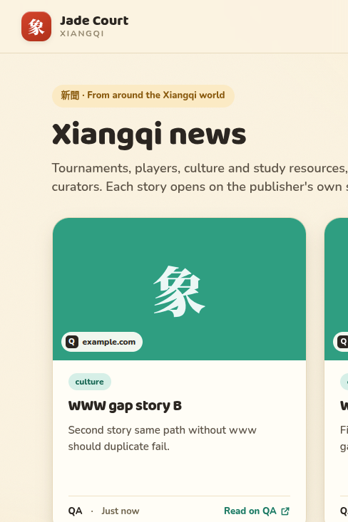

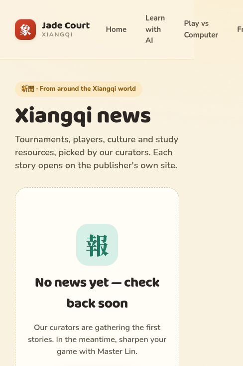

### Admin `/admin/news` (real Mongo)

- **Standalone layout** (no public topbar/footer); **`meta robots noindex`**.
- Token gate → list with filters/search; **Publish from row** on URL-only draft opens editor with **validation errors** (no silent failure).
- **Manual fallback** after preview failure: “Couldn't fetch details — fill them in manually”.
- **409 duplicate** in UI with **Edit existing item** link.
- Publish/list/edit flow works when fields are entered manually; items appear on `/news` without redeploy (seed + existing published rows).

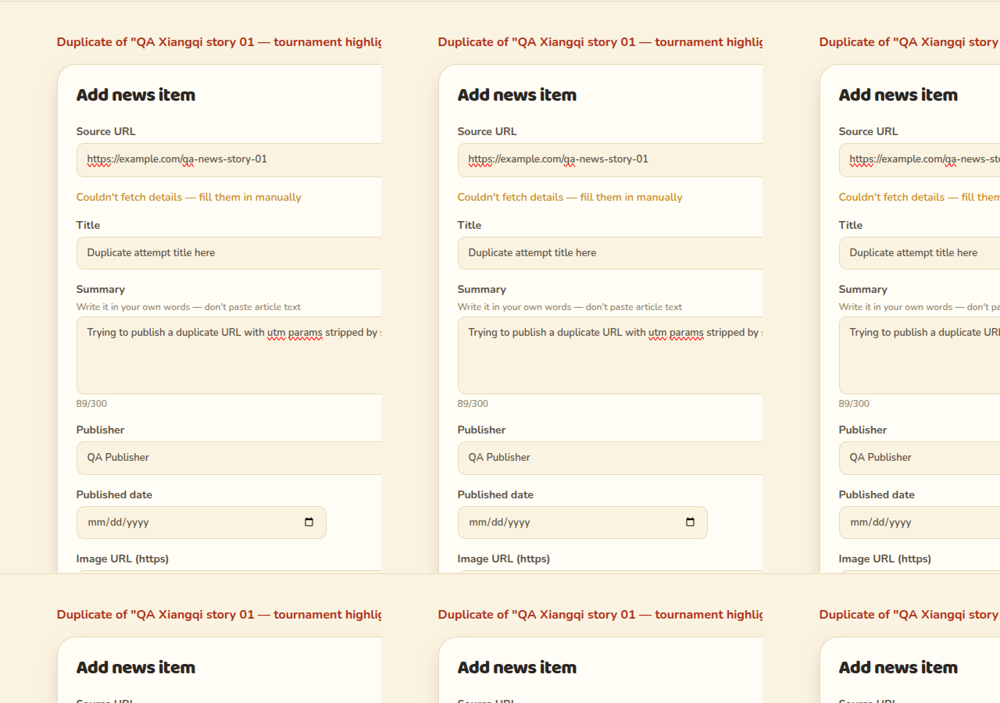

### Security / adversarial notes

- **DNS rebinding:** Not runtime-tested; **`metadata.test.ts`** includes pinned lookup ignoring rebinding on second DNS answer — **noted as unit-covered only**.
- **Slow body / 5s deadline:** Not runtime-tested; unit tests mock Undici — **noted as unit-covered only**.
- **`www` / http/https duplicate gap:** Confirmed — two published items for `https://www.example.com/qa-www-gap` and `https://example.com/qa-www-gap` (both **201**). Known minor from adversarial review.

## Bugs

### 1. Live metadata preview always fails (blocker) — **server**

|                    |                                                                                                                                                                                                                                                                                                   |
| ------------------ | ------------------------------------------------------------------------------------------------------------------------------------------------------------------------------------------------------------------------------------------------------------------------------------------------- |
| **Severity**       | Blocker                                                                                                                                                                                                                                                                                           |
| **Steps**          | 1. Start server with `ADMIN_TOKEN` and Mongo. 2. `POST /api/admin/news/preview` with `Authorization: Bearer <token>` and body `{ "url": "https://httpbin.org/html" }` (also tried Wikipedia, chess.com — same result).                                                                            |
| **Expected**       | **200** with parsed metadata (or **502** only when source is unreachable/HTML invalid).                                                                                                                                                                                                           |
| **Actual**         | **502** `{ "error": "fetch_failed" }` for every public HTTPS URL tested.                                                                                                                                                                                                                          |
| **Evidence**       | Direct Node repro in worktree: `fetchPageMetadata('https://httpbin.org/html')` throws `MetadataFetchFailedError`. Undici error cause: `ERR_INVALID_IP_ADDRESS: Invalid IP address: undefined` when using `createPinnedMetadataAgent`. Native `fetch('https://httpbin.org/html')` returns **200**. |
| **Suspected area** | `apps/server/src/news/metadata.ts` — `createPinnedConnectLookup` / Undici `Agent` `connect.lookup` incompatible with Undici 7 / Node 24 connect path (lookup callback arity / hostname mismatch).                                                                                                 |
| **Screenshot**     | Admin manual fallback after failed fetch: 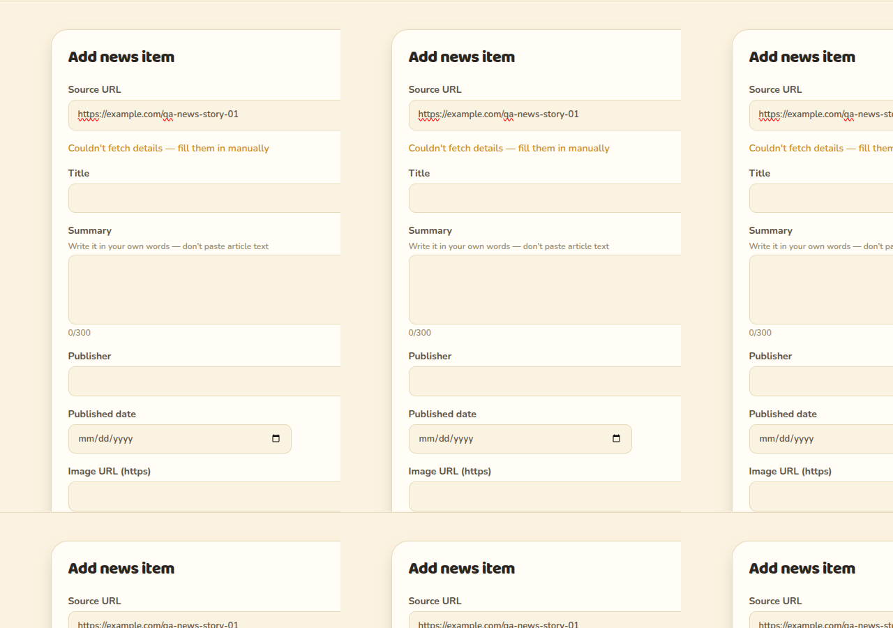                                                                                                                                                                                            |

**Impact:** Curators cannot get OG prefill; **`duplicateOf` in preview** never runs (preview fails before duplicate check on existing URLs). Acceptance “prefilled form within 5 s” is not met except via degraded manual path.

### 2. `www` host not deduplicated (minor, known) — **server**

|                    |                                                                                                                 |
| ------------------ | --------------------------------------------------------------------------------------------------------------- |
| **Severity**       | Minor                                                                                                           |
| **Steps**          | Publish `https://www.example.com/qa-www-gap`, then publish `https://example.com/qa-www-gap` with full metadata. |
| **Expected**       | Second create → **409 duplicate** (or preview `duplicateOf`).                                                   |
| **Actual**         | Both **201**; two cards on public `/news`.                                                                      |
| **Suspected area** | `apps/server/src/news/normalizeUrl.ts`                                                                          |

### 3. Missing browser screenshots for loading skeleton and card hover/focus (QA gap only)

|              |                                                                                                                                                                                                                       |
| ------------ | --------------------------------------------------------------------------------------------------------------------------------------------------------------------------------------------------------------------- |
| **Severity** | N/A (process)                                                                                                                                                                                                         |
| **Note**     | Loading skeleton and hover/focus not captured in this pass (API too fast for skeleton; hover not scripted). Behavior covered by `NewsScreen.test.tsx` / `NewsCard.test.tsx` and partial visual check on loaded cards. |

## Not tested in this environment

| Item                                            | Reason                                                                                                                                                                                                |
| ----------------------------------------------- | ----------------------------------------------------------------------------------------------------------------------------------------------------------------------------------------------------- |
| Live OG prefill on a real Xiangqi article       | Blocked by bug #1                                                                                                                                                                                     |
| Preview `duplicateOf` before fetch              | Blocked by bug #1 (preview never succeeds on example.com URLs)                                                                                                                                        |
| Runtime DNS rebinding egress                    | Relied on unit test per reviewer hint                                                                                                                                                                 |
| Slow-response body beyond 5s                    | Relied on unit test                                                                                                                                                                                   |
| Admin **row alert** on **503** after Mongo loss | Stopping Docker did not produce a visible row error in-browser (patch may still succeed on pooled connection); **503** API behavior verified on `:3143`; row UI covered in `AdminNewsScreen.test.tsx` |
| Card hover/focus screenshots                    | Not captured (see bug 3)                                                                                                                                                                              |
| Loading state screenshot                        | Not captured; skeleton verified in unit tests                                                                                                                                                         |

## Tests added by QA

None (report-only pass).

## Summary for PR

- **Do not merge** until metadata preview works against at least one real HTTPS URL in a non-mocked integration test.
- Re-test preview, `duplicateOf`, and curator happy path after fix.
- Optional: document or fix `www` duplicate gap (already known minor).

---

## Re-test 2026-10-14

**Updated verdict: PASS WITH ISSUES** — Bug #1 (live preview) is **fixed**. Curator happy path works end-to-end with real OG prefill. **Minor:** `www` duplicate gap unchanged (not re-tested this pass).

### CI status (developer-reported)

Lint, format:check, typecheck, `test:coverage` (**364** tests, including `metadata.connect.test.ts`), and `test:e2e` (23/23) reported pass. The prior integration-test gap for pinned Undici connect is addressed in CI via the new connect test.

### Live preview API (`POST /api/admin/news/preview`)

| URL                                     | HTTP | Time    | Notable fields                                                                                 |
| --------------------------------------- | ---- | ------- | ---------------------------------------------------------------------------------------------- |
| `https://en.wikipedia.org/wiki/Xiangqi` | 200  | ~265 ms | `title`: “Xiangqi - Wikipedia”; `imageUrl`: Wikimedia board SVG; `publisher`: en.wikipedia.org |
| `https://github.com`                    | 200  | ~550 ms | `title`, `description`, CTF `imageUrl`, `publisher`: GitHub                                    |
| `https://www.bbc.com/news`              | 200  | ~345 ms | `title`, long `description`; `imageUrl`: null                                                  |

**Regression:** `localhost`, `169.254.169.254`, `100.64.0.1` → **400 `blocked_url`**.  
**Timeout:** `https://httpbin.org/delay/10` → **502 `fetch_failed`** in ~5 s (within spec deadline).

**`duplicateOf` (API):** After publishing GitHub item, preview of `https://github.com/?utm_campaign=retest` returned **200** with `duplicateOf: { id, title, status: "published" }`.

### Admin UI (browser, `:5241`)

1. Pasted `https://en.wikipedia.org/wiki/Xiangqi` → **Fetch details** prefilled title, publisher, image URL within ~2 s.
2. Added curator summary + **learning** tag → **Publish** → item on `/news` with Wikimedia thumbnail and link to Wikipedia.

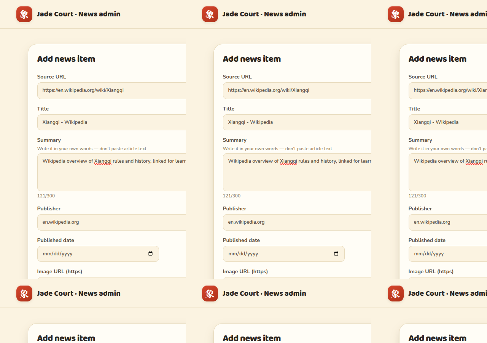

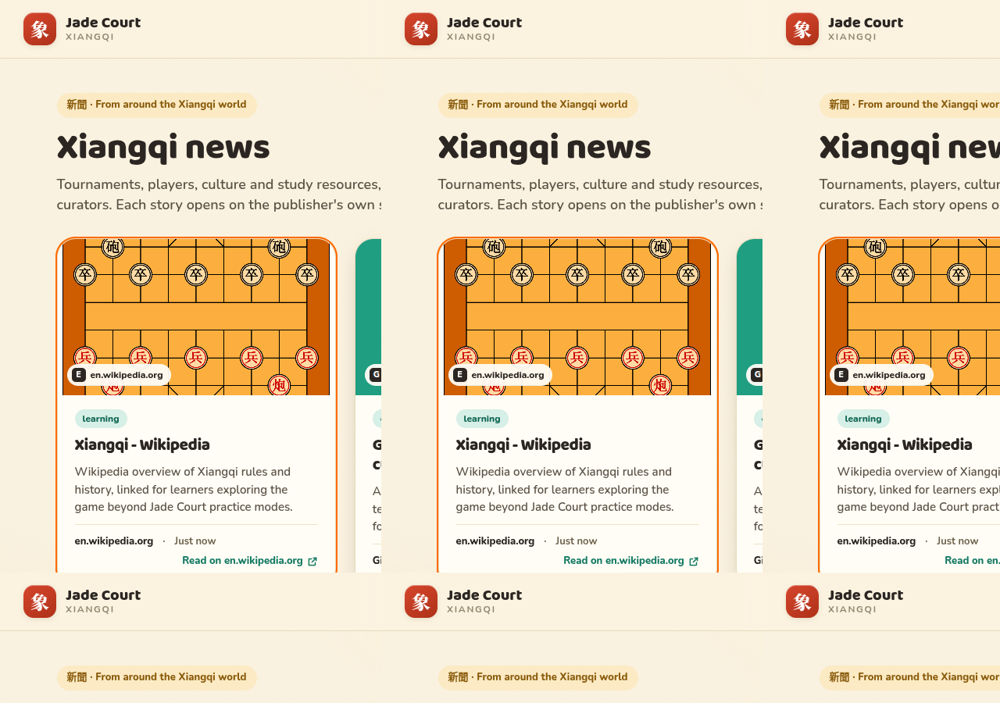

3. **Preview duplicate (UI):** `https://github.com/?utm_source=retest-qa` → prefilled + banner “This URL may duplicate …” with **Open existing** (screenshot 17).

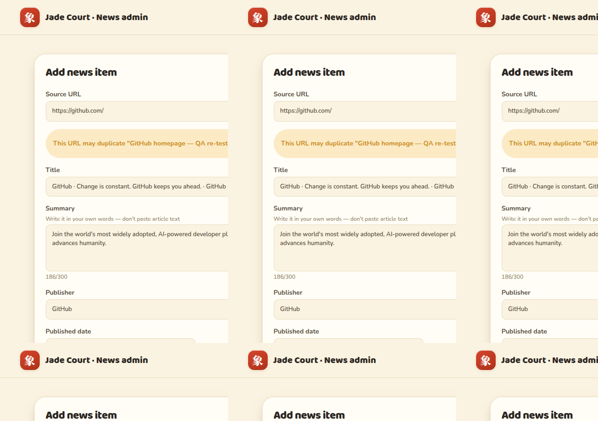

4. **Manual fallback:** `https://httpbin.org/delay/10` → “Couldn't fetch details — fill them in manually” after timeout (screenshot 18).

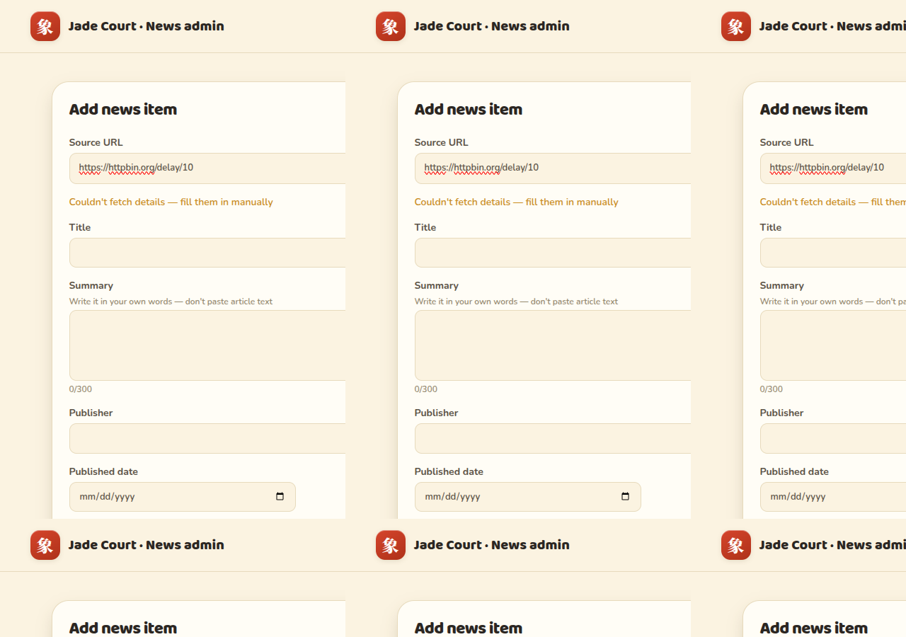

### Public `/news` — missing first-pass screenshots

- **Loading skeleton:** Playwright delayed `/api/news` 15 s; captured six shimmer cards (`data-testid="news-skeleton-grid"`).

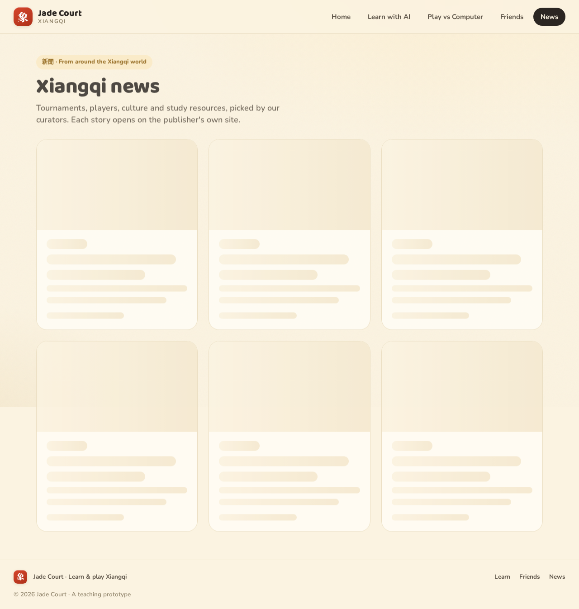

- **Card hover / focus:** Playwright `hover()` and `focus()` on Wikipedia card.

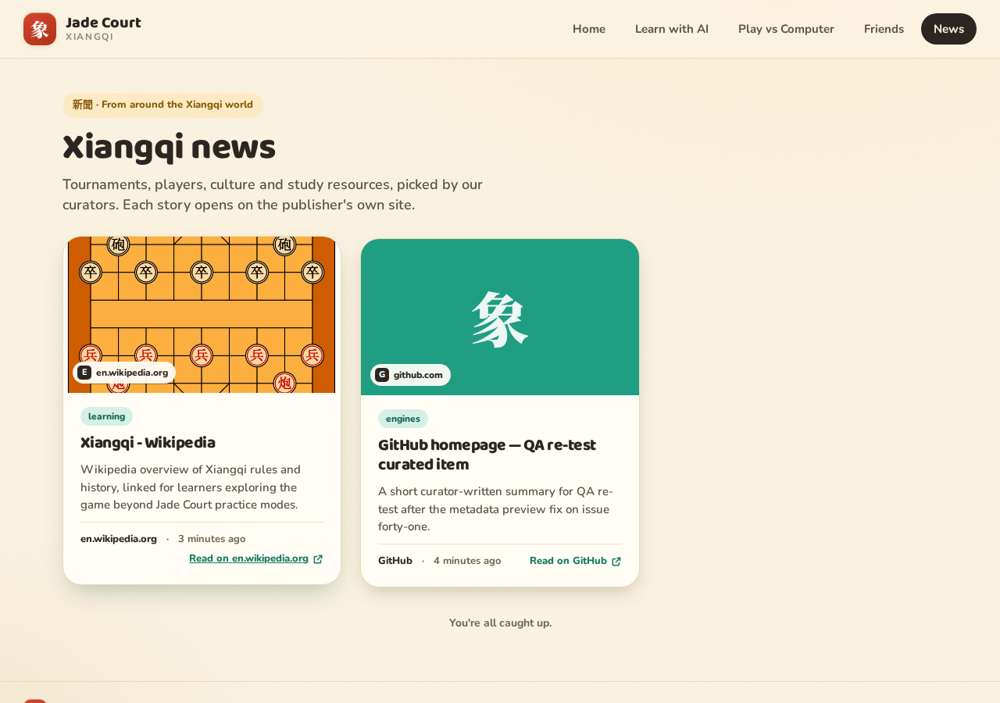

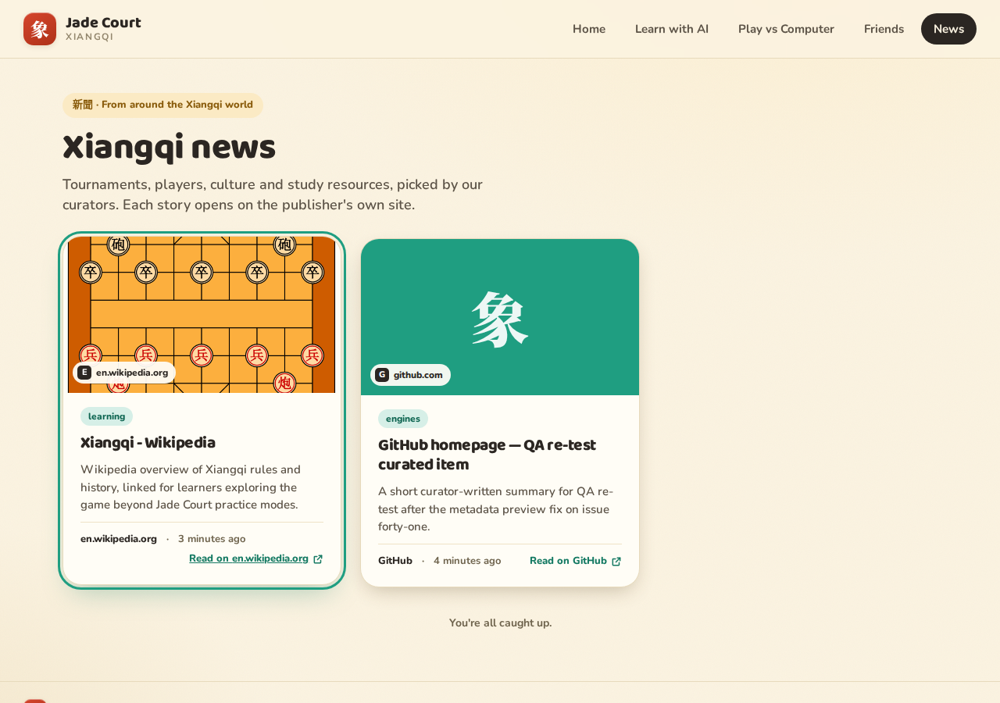

### Bugs from first pass

| Bug                                      | Re-test result                                                |
| ---------------------------------------- | ------------------------------------------------------------- |
| **#1 Live preview 502 (blocker)**        | **Fixed** — verified on 3 live URLs + full admin publish flow |
| **#2 www duplicate (minor)**             | **Still open** (known; not re-run)                            |
| **#3 Missing loading/hover screenshots** | **Closed** — screenshots 14–16 added                          |

### New bugs

None found in this re-test.

### Not tested (re-test)

- Runtime DNS rebinding egress (still unit-test coverage only).
- `www` / scheme duplicate behavior.
- Admin row **503** alert after Mongo loss (unchanged from first pass).
