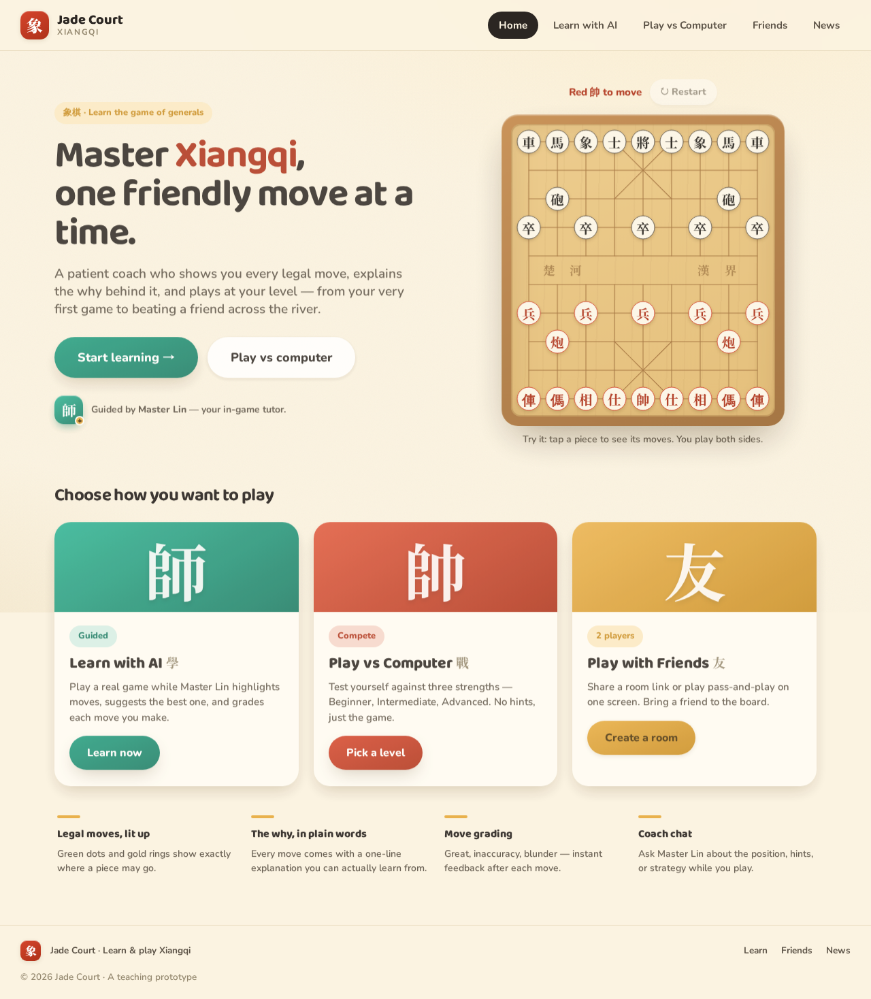
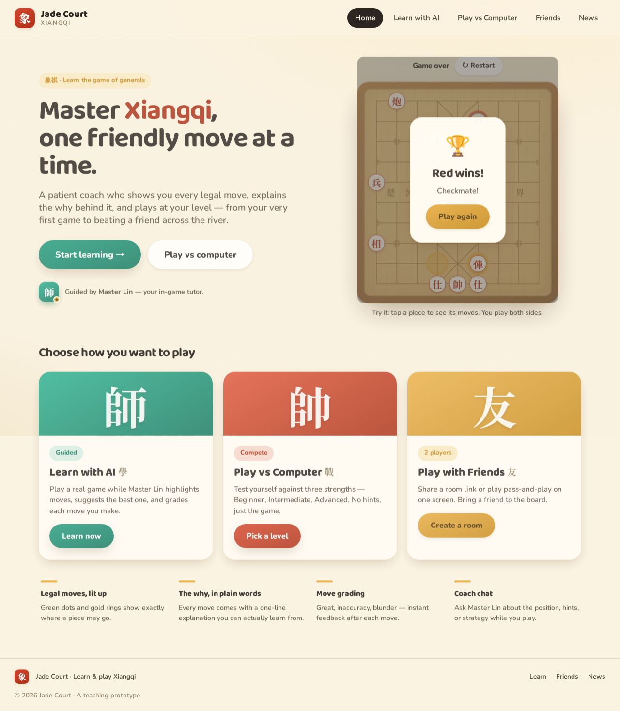
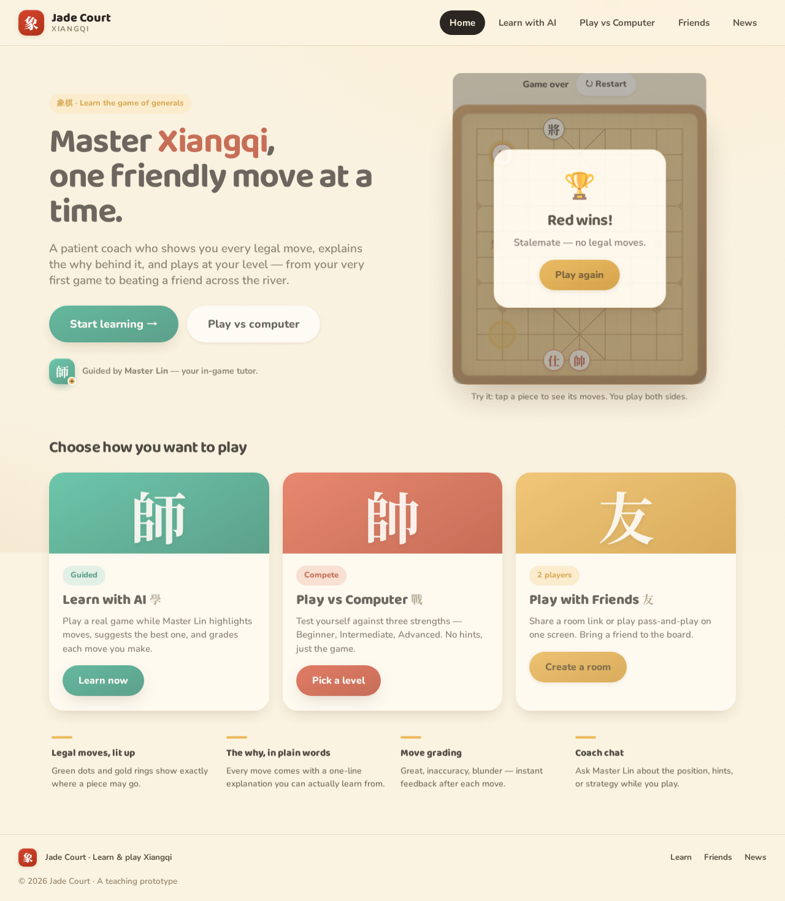

# QA report — Issue #49 playable homepage demo board

**Date:** 2026-10-14  
**Worktree:** `issue-49-home-demo-board` (uncommitted changes)  
**Verdict:** **PASS**

---

## 1. CI status (developer-reported)

Developer final round reported all green with zero warnings:

| Check | Status |
| --- | --- |
| `pnpm lint` | Pass (reported) |
| `pnpm format:check` | Pass (reported) |
| `pnpm typecheck` | Pass (reported) |
| `pnpm build` | Pass (reported) |
| `pnpm test:coverage` | Pass — 149 web unit tests (reported) |
| `pnpm test:e2e` | Pass — 31 tests (reported) |

**QA re-ran (scoped, not full CI):**

- Unit: `HomeDemoBoard.test.tsx`, `homeDemoStorage.test.ts`, `useXiangqiGame.test.ts` — **46/46 passed**
- E2E: `home.spec.ts`, `play.spec.ts`, `multiplayer.spec.ts` (+ bundled specs in default run) — **31/31 passed**

### Test coverage review

| Area | Tests |
| --- | --- |
| Storage parse/serialize, caps, corrupt JSON | `homeDemoStorage.test.ts` (4) |
| Board UI, overlays, persistence, corrupt/illegal saves | `HomeDemoBoard.test.tsx` (13) + fixtures |
| `initialMoves` replay, rejection, terminal positions | `useXiangqiGame.test.ts` (extended) |
| Playable hero + reload + restart | `e2e/home.spec.ts` |

**Note (test quality, not product):** E2E asserts `.point.first()` on select; in `XQBoard`, every piece wrapper uses class `point`, so that assertion does not specifically prove legal-move dots. Unit tests and browser QA use `.marker .dot` instead.

**Known accepted limitation (not a failure):** A single session with **1001+ plies** can write storage that **`parseHomeDemoSave` rejects on reload** (cap `HOME_DEMO_MAX_SAVED_PLIES = 1000`). Reload correctly shows a fresh board and clears the key (~400ms, no hang).

---

## 2. Verified behaviors

### Homepage demo board (browser — headless Chromium via Playwright against Vite dev `:5222`; helper script kept outside the repo at `/tmp/qa-issue-49/run-qa.mjs`)

- Caption: *Try it: tap a piece to see its moves. You play both sides.*
- Turn indicator **Red 帥 to move** / **Black 將 to move** with pass-and-play colors; **Game over** when finished.
- Legal-move **dots** (`.marker .dot`) on select; **capture** styling (`.capture-point` / rings) on a loaded tactical line.
- Red then Black alternation; opposite side not selectable; deselect via re-tap or board background.
- **Check!** pill + `.incheck` general on restored check position (11 plies of checkmate fixture).
- **Checkmate** overlay: **Red wins!**, **Checkmate!**, **Play again**; survives reload.
- **Stalemate** overlay: **Red wins!**, **Stalemate — no legal moves.**; **Play again** clears storage.
- **Restart** disabled with zero plies; enabled after moves (E2E + manual flow).
- `localStorage` key `jade-court-home-demo` shape `{ v: 1, moves: [...] }`; mid-game reload restores turn, pieces, **last-move** dots (2 after two plies).
- Illegal ply `[7,1]→[0,0]`, corrupt JSON, wrong-version, and **1001-move** payload → fresh board, key removed, **no console errors**.
- After illegal-save recovery, new legal plies **persist and reload** (adversarial hint #1 — no stuck “no save” in current code).
- Red general at row 9 (`rG`), **32 pieces**, board not flipped (`flip={false}`).

### Regression smoke

- **Play vs Computer** — E2E suite passed (moves, take-back, redo, opponent API).
- **Learn with AI** — included in E2E run (stubbed LLM paths).
- **Multiplayer** — online room E2E passed; **pass-and-play** manually verified (Red → Black turn after one ply).

---

## 3. Bugs

None found in product code during this pass.

---

## 4. Not tested

- **Hero layout pixel diff** vs pre-change (visual only; caption + `cell={42}` confirmed in DOM).
- **Responsive / mobile** hero (out of scope per issue).
- **Server / engine** (frontend-only feature).
- **Learn** screen in a live browser with real LLM (E2E stubs only).
- **StrictMode double-mount** as a dedicated automated case (illegal/corrupt paths exercised in dev build; no console errors observed).

---

## 5. Tests added by QA

This pass added **`report.md`** and **`screenshots/`** only (no repo-local helper scripts). No changes to product code or Vitest/Playwright specs.

---

## 6. Artifacts

- Report: `docs/reports/qa/2026-10-14-issue-49-home-demo-board/report.md`
- Screenshots: `docs/reports/qa/2026-10-14-issue-49-home-demo-board/screenshots/`
- Optional local-only browser helper (not committed): `/tmp/qa-issue-49/run-qa.mjs`, `/tmp/qa-issue-49/run-qa-results.json`
