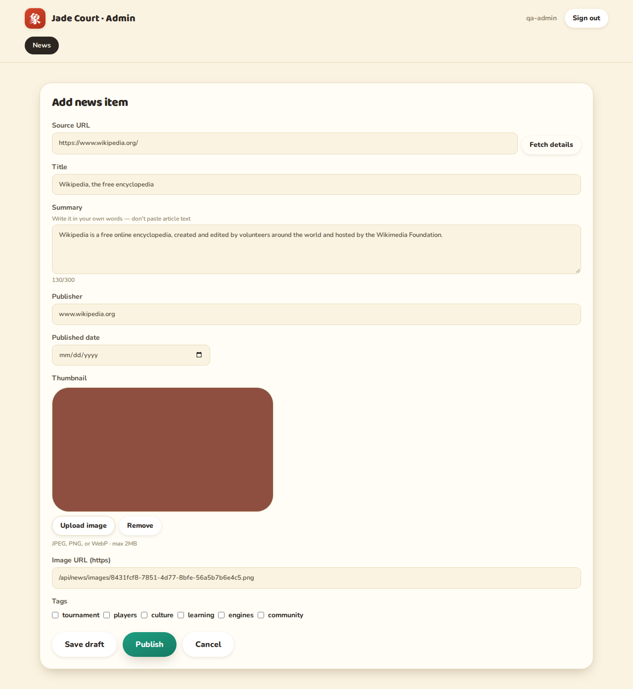
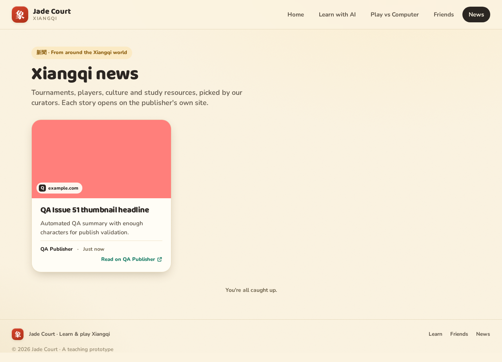
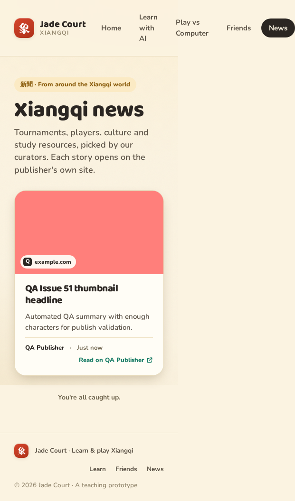

# QA report — Issue #51 curator news thumbnail upload

**Date:** 2026-10-15  
**Worktree:** `issue-51-curator-thumbnail-upload`  
**Verdict:** **PASS WITH ISSUES** (acceptance criteria met; known lifecycle/concurrency limits documented below)

## CI status

Per developer reports (not re-run in QA): `pnpm lint`, `format:check`, `typecheck`, `test:coverage`, and `build` — all **pass**.  
**QA re-ran:** `pnpm test:e2e` — **34/34 pass** (~24s).

**Test coverage (review):** New behavior is covered by server route tests (`news.test.ts`, `imageStorage.test.ts`), Mongo partial `$set` test, web `newsApi` / validation / `AdminNewsScreen` / `NewsCard` / `adminNewsForm`, and E2E upload→publish→`/news`. No `.skip` / `.only` or loosened assertions observed in the issue diff. Gaps called out under **Not tested**.

## Environment

- Dev: `pnpm dev` on **5173 / 3001** with `ADMIN_USERS=qa-admin:qa-pass`, `ADMIN_SESSION_SECRET` (32+ chars), `NEWS_IMAGE_DIR` → `docs/reports/qa/.../qa-images/`
- MongoDB: connected via repo `.env` `MONGODB_URI`
- LLM / Pikafish: disabled (irrelevant to this feature)

## Verified behaviors

| Criterion | Result | Evidence |
|-----------|--------|----------|
| Paste URL → Fetch details fills hotlinked `og:image` | **Pass** | Browser: Wikipedia preview → `https://upload.wikimedia.org/...` — [02-admin-after-fetch-preview.png](screenshots/02-admin-after-fetch-preview.png) |
| Upload JPEG/PNG/WebP ≤2MB replaces thumbnail; visible on `/news` after publish | **Pass** | Upload set `/api/news/images/<uuid>.png`; publish succeeded; card on `/news` — [03-admin-after-upload.png](screenshots/03-admin-after-upload.png), [06-public-news-feed.png](screenshots/06-public-news-feed.png) |
| Re-run preview after upload replaces with `og:image` | **Pass** | After upload, Fetch details restored Wikimedia URL (differs from hosted path) — [04-admin-after-repreview.png](screenshots/04-admin-after-repreview.png) |
| Wrong type → `400 invalid_image`; >2MB → `413` | **Pass** | `qa-api-probe.mjs` |
| 2 MiB − 1 and exactly 2 MiB file bytes → `201` | **Pass** | `qa-api-probe.mjs` |
| Upload requires admin session; public GET | **Pass** | `401` without Bearer; `200` GET without auth — `qa-api-probe.mjs` |
| Bad filename → `404`; traversal encoded → `404` | **Pass** | `qa-api-probe.mjs` |
| Replace/delete cleans file when last reference gone; shared path kept until last ref | **Pass** | Sequential API: two items same path → delete one → `200`; delete both → `404`; PATCH replace removes sole-ref old file — `qa-api-probe.mjs` |
| Thumbnails via Vite proxy (`/api` on :5173) | **Pass** | `curl http://localhost:5173/api/news/images/<uuid>.png` → `200` |
| `VITE_API_URL` prefix for `` | **Pass** (unit) | `newsApi.test.ts` `resolveNewsImageUrl` (not re-tested with separate Vite env restart) |
| Admin UI: upload in flight disables save/publish/fetch | **Pass** (unit) | `AdminNewsScreen.test.tsx` |
| Stale upload after cancel ignored | **Pass** (unit) | `AdminNewsScreen.test.tsx` |

## Bugs

None blocking issue **#51** acceptance criteria in sequential / manual testing.

### Known limitations (documented open items — not regressions vs stated scope)

| Severity | Topic | Notes |
|----------|--------|--------|
| **Major (accepted)** | Orphan files on disk | Upload then abandon (cancel/remove without save) leaves files in `NEWS_IMAGE_DIR`; no GC in #51. Observed leftover files after API boundary tests (`qa-images/`). |
| **Major (accepted)** | Concurrent ref-count / unlink race | Two sessions racing count→unlink vs new reference not exercised; adversarial review accepted for #51. |
| **Minor** | Magic-byte only validation | Non-image prefix bytes could pass; no decode/bomb limits tested. |

## Not tested

- **Concurrent PATCH** (image replace vs title-only) against live Mongo — mitigated by Mongo `$set` only patched fields (unit test); no concurrent integration test.
- **`VITE_API_URL` set** end-to-end in browser (unit tests only).
- **WebP/JPEG** upload variants in manual pass (PNG only; server sniff tests cover types).
- **Cleanup failure after commit** — route test with throwing store; not re-run manually.
- **Orphan cleanup** on UI Cancel/Remove with disk inspection (scope: accepted orphans).

## Tests added (QA)

| File | Purpose |
|------|---------|
| `qa-api-probe.mjs` | Automated curl-style API checks against running dev server |
| `qa-browser-screenshots.mjs` | Playwright harness (run via `pnpm exec node` from `apps/web`); screenshots in `screenshots/` |

## Sign-off

Feature is **ready to merge** for stated acceptance criteria. Track orphan disk usage and concurrent cleanup as follow-up if product wants stronger guarantees.
