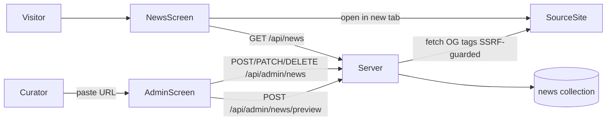

# Requirements — Curated Xiangqi news (public feed + admin curation)

|                  |                                                                          |
| ---------------- | ------------------------------------------------------------------------ |
| **Status**       | Draft for review (P0 implementation)                                     |
| **Owner**        | Dang                                                                     |
| **Last updated** | 2026-10-13                                                               |
| **Related**      | [#41 curated news page](https://github.com/sea2709/jade-court/issues/41) |

---

## 1. Summary

- **Public `/news`:** a list of curated Xiangqi news (tournaments, players, culture, learning resources, engines/AI). Each card shows a title, our own short summary, the publisher, the date and a thumbnail, and links to the **original source** in a new tab.
- **Admin `/admin/news`:** curators paste a source URL. The server fetches the page's Open Graph metadata to prefill the form. The curator edits the fields, writes a summary, adds tags, and saves the item as a draft or publishes it.
- **Storage:** MongoDB `news` collection, with new Hono routes. Admin access uses username/password login and HMAC session tokens (`ADMIN_USERS`, `ADMIN_SESSION_SECRET`); Clerk admin roles may replace this later.

**Scope: P0 only.** Delivered as one PR containing this document and the implementation. **Design:** desktop prototype at [`docs/design/news/Main.dc.html`](../design/news/Main.dc.html) (public page only).



## 2. Where we are today

- Jade Court has no news or editorial surface; navigation covers Play, Learn, and Friends.
- MongoDB is optional (`apps/server/src/db.ts`); finished games persist when configured, but there is no `news` collection yet.
- Authentication is guest-only (`x-guest-id`); no Clerk or admin roles in the web bundle.

This feature adds server routes, a storage abstraction, and (in parallel web work) public and admin screens.

## 3. Goals and non-goals

**Goals**

1. A trustworthy, attributed news feed curated by humans.
2. Adding an item takes under a minute (URL paste → OG prefill → edit → publish).
3. Zero-friction outbound links to the original publisher.

**Non-goals (v1)**

- Automatic scraping or RSS ingestion, republishing full article text, comments, user submissions, LLM summaries, rehosting images, multiple admin accounts or roles, multi-language UI (English only), an on-site detail page (link-out only).

**Deferred (P1/P2 — not in P0 PR)**

| ID      | Feature                                  |
| ------- | ---------------------------------------- |
| NEWS-06 | Tag/language filter chips                |
| NEWS-07 | Featured hero card                       |
| NEWS-09 | Home teaser; outbound click counts       |
| NEWS-25 | Live card preview in admin               |
| NEWS-26 | Bulk import; dead-link check             |
| —       | NetworkFirst PWA caching for `/api/news` |

**Dropped from v1:** `lang` and `featured` fields (not in the data model, form, or preview response).

## 4. Users

| Persona             | Need                                                          |
| ------------------- | ------------------------------------------------------------- |
| **Visitor**         | Scan recent Xiangqi news and open stories on publisher sites  |
| **Curator (admin)** | Add, edit, publish, archive, and delete curated items quickly |

## 5. Functional requirements

Requirement IDs: `NEWS-xx`. **P0** = this release; deferred IDs listed in §3.

### 5.1 Public page `/news`

- **NEWS-01 (P0)** Add a "News" entry to `NAV` and the footer in `apps/web/src/App.tsx`, and a `news` route inside the `<App />` layout in `apps/web/src/main.tsx`.
- **NEWS-02 (P0)** Show published items only, sorted newest first by `sortAt` (`publishedAt ?? createdAt`).
- **NEWS-03 (P0)** Each card shows tags, title, summary (up to 300 characters, written by us), publisher, publish date (relative, absolute in a tooltip), a thumbnail (jade 象 placeholder when missing or broken), and a domain badge with the publisher's initial. See §8 Design.
- **NEWS-04 (P0)** The whole card is a single `<a href={sourceUrl} target="_blank" rel="noopener noreferrer">`. It contains "Read on {publisher}" with an external-link icon as a span, not a nested link.
- **NEWS-05 (P0)** Pagination: a "Load more stories" button using a cursor on `sortAt` + `_id`, 12 items per page; "You're all caught up." when the list ends.
- **NEWS-08 (P0)** States: loading skeleton cards; empty state; error state with retry; offline note inside the error state when `navigator.onLine` is false. An empty list when MongoDB is not configured shows the empty state.

### 5.2 Admin `/admin/news`

- **NEWS-20 (P0)** Standalone layout (outside the public topbar/footer), not linked anywhere, `<meta name="robots" content="noindex">`. Admins sign in at `/admin/login`; the session `{ token, username, expiresAt }` is kept in `sessionStorage` and sent as `Authorization: Bearer <token>`. A 401 clears it and redirects to login. "Sign out" clears the session.
- **NEWS-21 (P0)** List of all items (draft, published, archived) with a status filter and search by title/publisher. Row actions: edit, publish, unpublish (back to draft), archive; archived items can be re-published, or hard-deleted after a confirmation.
- **NEWS-22 (P0)** "Add item" flow: paste URL → `POST /api/admin/news/preview` returns metadata from Open Graph, `twitter:*`, `<title>`, and `article:published_time`. Form prefilled; fields editable. Known normalized URL shows `duplicateOf` warning. Failed fetch → manual entry.
- **NEWS-23 (P0)** Fields and validation — see §7 API validation rules.
- **NEWS-24 (P0)** Duplicate guard: normalized URLs (lowercase host, strip `utm_*` / `fbclid` / fragment, prefer canonical) under a unique index; duplicate on create or `sourceUrl` edit → 409 with existing item reference.

## 6. Data model

MongoDB collection `news`:

```ts
{
  _id,
  sourceUrl,
  normalizedUrl, // unique
  title,
  summary,
  publisher,
  sourceDomain,
  imageUrl?,
  publishedAt?,
  sortAt, // publishedAt ?? createdAt; recomputed when publishedAt changes
  tags: string[],
  status: 'draft' | 'published' | 'archived',
  createdAt,
  updatedAt,
  publishedOnSiteAt?, // set on first publish, kept on unpublish
}
```

**Indexes:** `{ normalizedUrl: 1 }` unique; `{ status: 1, sortAt: -1, _id: -1 }`.

No `lang`, `featured`, or `clicks`.

When MongoDB is not configured, `GET /api/news` returns `{ items: [], nextCursor: null }` and admin routes return `503 { error: 'news_storage_unavailable' }` after auth.

**Storage abstraction:** `NewsStore` in `apps/server/src/news/store.ts` with `MongoNewsStore` and `MemoryNewsStore` (tests). `createApp(deps?: { newsStore?: NewsStore | null })` defaults to Mongo when `MONGODB_URI` is set, else `null`.

## 7. API (`apps/server`)

### 7.1 Public — `GET /api/news?cursor=&limit=`

- **200** `{ items: PublicNewsItem[], nextCursor: string | null }`
- Limit default **12**, capped at **12**.
- Published only; sorted `sortAt` desc then `_id` desc.
- Cursor: opaque string encoding `sortAt` + `id`.
- No store → `{ items: [], nextCursor: null }`.
- Invalid cursor → **400** `{ error: 'invalid_cursor' }`.

`PublicNewsItem`:

```ts
{
  id: string;
  sourceUrl: string;
  title: string;
  summary: string;
  publisher: string;
  sourceDomain: string;
  imageUrl?: string;
  publishedAt?: string; // ISO
  sortAt: string; // ISO
  tags: string[];
}
```

### 7.2 Admin — `/api/admin/news` (Bearer `adminAuth`, every response `Cache-Control: no-store`)

| Method / path              | Response                                                                                                                                                                                                      |
| -------------------------- | ------------------------------------------------------------------------------------------------------------------------------------------------------------------------------------------------------------- |
| `GET /?status=&q=&cursor=` | `{ items: AdminNewsItem[], nextCursor }`, 50 per page. `status` ∈ draft \| published \| archived (omit = all). `q` = case-insensitive substring on title or publisher (regex-escaped).                        |
| `POST /preview` `{ url }`  | **200** `{ title, description, imageUrl, publisher, publishedAt, canonicalUrl, duplicateOf? }` (missing as `null`). **400** `{ error: 'invalid_url' \| 'blocked_url' }`. **502** `{ error: 'fetch_failed' }`. |
| `POST /`                   | **201** `AdminNewsItem`                                                                                                                                                                                       |
| `PATCH /:id`               | **200** `AdminNewsItem`; **404** `{ error: 'not_found' }`                                                                                                                                                     |
| `DELETE /:id`              | **204** hard delete; **404** if missing                                                                                                                                                                       |

`AdminNewsItem` = `PublicNewsItem` & `{ normalizedUrl, status, createdAt, updatedAt, publishedOnSiteAt? }` (dates ISO; drafts may have empty title/summary/publisher).

- Validation errors → **400** `{ error: 'validation', fields: { [field]: message } }`.
- Duplicate `normalizedUrl` → **409** `{ error: 'duplicate', existing: { id, title, status } }`.
- No store → **503** `{ error: 'news_storage_unavailable' }` (after auth).

### 7.3 Admin auth (`POST /api/admin/login`, `GET /api/admin/me`, `adminAuth`)

- **Login** (`POST /api/admin/login`, public): body `{ username, password }` checked against `ADMIN_USERS` (`user:pass,user2:pass2`, split on first `:`). Wrong user or password → **401** `{ error: 'invalid_credentials' }` (same response shape for both). After 10 failures per IP + username within 15 minutes → **429** `{ error: 'rate_limited' }`. Success → **200** `{ token, username, expiresAt }` (HMAC-signed Bearer token). All admin responses include `Cache-Control: no-store`.
- **`GET /api/admin/me`:** Bearer session required (`adminAuth` per route); **200** `{ username }`.
- **`adminAuth` on `/api/admin/news/*`:** verify HMAC session (`ADMIN_SESSION_SECRET`), expiry, and that `sub` is still in `ADMIN_USERS`. Missing/malformed/bad signature → **401** `{ error: 'unauthorized' }` (counts toward per-IP token bucket). Expired or revoked user → **401** without counting toward the IP bucket.
- No configured users or blank `ADMIN_SESSION_SECRET` → **503** `{ error: 'admin_disabled' }` on login, `/me`, and news admin.
- Bad Bearer tokens: 10 failures per remote IP within 15 minutes → **429** (in-memory; `@hono/node-server/conninfo`, constant fallback in tests).

### 7.4 Validation rules

- `sourceUrl`: required, http(s) only (reject `javascript:` etc.).
- **Drafts** (status omitted or `draft`): only `sourceUrl` required.
- **Published** (create, PATCH to publish, or edit while published): `title` 1–160 chars; `summary` 20–300 chars; `publisher` non-empty; `imageUrl` optional but https if present (validated on every save); `publishedAt` optional valid date; `tags` ⊆ `tournament`, `players`, `culture`, `learning`, `engines`, `community`.
- `status: archived` from any state; archived → published allowed (full validation).
- Trim and length-cap plain-text fields.

### 7.5 Metadata fetcher (`news/metadata.ts`)

SSRF-guarded: http(s) only; ports 80/443; DNS resolve and reject loopback/private/link-local/unique-local/unspecified/metadata (IPv4 + IPv6, incl. IPv4-mapped); re-check on each redirect (manual, max 3); 5 s timeout; 1 MB body cap; `text/html` only; User-Agent `JadeCourtNewsBot/1.0`; parse `<head>` with `node-html-parser` (OG → twitter → fallbacks).

### 7.6 Env

- `.env.example`: `ADMIN_USERS=`, `ADMIN_SESSION_SECRET=` (32+ random chars), `ADMIN_SESSION_TTL_HOURS=8` (server only, no `VITE_` prefix).

## 8. Web (`apps/web`)

- `src/lib/adminApi.ts` + `src/lib/newsApi.ts`: public and admin fetchers following `api<T>()` in `src/lib/api.ts`; Bearer session for admin; 401 clears stored session.
- `src/lib/formatNewsDate.ts`, `src/screens/NewsScreen.tsx`, `src/components/NewsCard.tsx`, `src/screens/AdminNewsScreen.tsx`.
- `/admin/news` route sibling of `<App />` layout (standalone).
- Tailwind v4 utilities plus `.news-card` / skeleton / state-panel in `src/index.css` `@layer components`.

### 8.1 Design (public `/news`)

Desktop prototype: [`docs/design/news/Main.dc.html`](../design/news/Main.dc.html). Implement with Tailwind tokens in `apps/web/src/index.css` (`--paper`, `--line-soft`, `--jade-deep`, `--red-deep`; Baloo 2 / Nunito / Noto Serif SC). Do not copy inline styles from the mockup.

- **Header:** eyebrow pill "新聞 · From around the Xiangqi world"; h1 "Xiangqi news"; subtitle about curators and opening on the publisher's site.
- **Layout:** `<main>` max 1180px; grid `repeat(auto-fill, minmax(300px, 1fr))`, 24px gap.
- **Card:** paper background, border, 24px radius; hover lift; 16:9 thumbnail; domain badge; tag chips; meta row with "Read on {publisher} ↗".
- **Loading / empty / error:** per issue #41 and prototype copy (skeletons, 報 / 斷 tiles, offline note, "Start learning →" to `/learn`).

**Admin (no prototype):** same visual language — paper cards, pill status filters, `.btn` / `.btn-primary` / `.btn-ghost`.

## 9. Non-functional and legal

- **Attribution:** always show publisher and link to source; store only title, our summary, and thumbnail URL — never article body. Hotlink OG images for v1; curator may clear `imageUrl`.
- **Security:** admin credentials and session secret never in the web bundle; admin routes `Cache-Control: no-store`; reject non-http(s) URLs on save.
- **Accessibility:** cards are real links with accessible name including "opens in new tab".
- **Performance:** list endpoint < 200 ms p95 with indexes.

## 10. Open questions

Resolved in #41: no detail page (link-out only); English-only UI; env-based admin accounts until Clerk admin roles (see Learn spec ACC-01).

## 11. Acceptance criteria

- [ ] Only published items in `GET /api/news`, newest first.
- [ ] Each card links to the exact source in a new tab with publisher and domain.
- [ ] `/news` matches prototype states at 1280px and mobile (web).
- [ ] Curator can paste URL, prefill within 5 s (or manual fallback), publish, see item on `/news` without redeploy.
- [ ] Draft saves with URL only; incomplete publish → 400.
- [ ] Preview `duplicateOf` for known URL; same article with different `utm_` → 409.
- [ ] Wrong/missing session → 401; unset admin config → 503; repeated login/token failures → 429; secrets absent from web assets.
- [ ] Preview refuses localhost, metadata IP, private ranges, redirects into private addresses.
- [ ] `/news` empty state when MongoDB not configured (not an error).
- [ ] CI clean: lint, format, typecheck, test:coverage, test:e2e.

## 12. Test plan

**Server (Vitest)**

- `news/normalizeUrl.test.ts` — host, tracking params, fragment, ports, schemes.
- `news/metadata.test.ts` — OG/twitter fallbacks, relative images, SSRF, redirects, timeout, body cap, non-HTML.
- `news/memoryStore.test.ts` — sort, cursor pagination, duplicates.
- `news/validate.test.ts` — draft vs publish rules.
- `admin/users.test.ts`, `admin/session.test.ts`, `routes/admin.test.ts`, `middleware/adminAuth.test.ts` — login, sessions, 401/503/429.
- `routes/news.test.ts` — full HTTP contract via `createApp({ newsStore })` + mocked metadata.

**Web (Vitest + Playwright)** — per issue #41 (parallel frontend work).

**Manual QA:** `/news` states vs prototype; `/admin/news` against local MongoDB; one live OG preview URL.
